# 01.1 · The project, the budget and the spending rules

In this course you train your own GPT on rented machines with your own money, so the first lesson is about the plan and the money, before any account or command. You will see the whole pipeline once, end to end, with the artifact each module leaves behind; then you turn the $500 cap into a budget file and a short set of spending rules that you follow on every machine you rent. Most projects like this do not fail on the model. They fail on a node somebody forgot to turn off.

## Goal

You end with a filled-in `budget.md`: the $500 plan broken down by module, your choice between the main path and the cheaper path, the eight spending rules signed with your name, the kill checklist, and the first line of the ledger. It moves into your project repo in [01.3](lesson-03.md) and every lesson that spends money adds a line to it.

## What you need

- About 50 minutes and a text editor. No accounts yet.
- The [Module 1 lab files](../../labs/module-01/) (download them now; you use all of them in this module).
- **Expected cost: $0.**

## Choices and costs

### The pipeline, end to end

```mermaid
flowchart LR
    subgraph prep["Prepare (CPU, cheap)"]
        A["FineWeb-Edu on Hugging Face"] -->|"02: download, verify"| B[("R2 bucket: raw parquet")]
        B -->|"03: train BPE, tokenize"| C[("token shards, tokenizer")]
    end
    subgraph pre["Pretrain (GPUs, expensive)"]
        C -->|"04: rent, benchmark"| D["measured tokens/s and real budget"]
        D -->|"05: 8xH100"| E["GPT-2 124M baseline"]
        E -->|"06: 1xH100"| F["ablations: your recipe"]
        F -->|"07: 8xH100"| G["your ~350M base model"]
    end
    subgraph post["Evaluate, align, ship"]
        G -->|"08"| H["eval report"]
        G -->|"09: SFT"| I["chat model"]
        I -->|"10: DPO + judge"| J["aligned model"]
        J -->|"11"| K["HF model, demo Space, tech report"]
    end
```



Everything lives in three places: your **GitHub repo** (code, configs, reports, `budget.md`), your **R2 bucket** (data, shards, checkpoints) and your **Hugging Face account** (the published model at the end). Rented machines hold nothing you cannot lose; they are clones of your repo that pull from the bucket and push back to it.

### What each module leaves you

| Module | You do | Artifact you keep |
|---|---|---|
| 1 Plan, accounts, guardrails | Accounts, tokens, secrets, alerts, project repo, CPU dry run | Repo with green tests, `budget.md`, alerts configured |
| 2 Data | Pick FineWeb-Edu, download ~93 GB, verify, store in R2 | Raw shards in the bucket, manifests, `DATA_CARD.md` |
| 3 Tokenizer and shards | Train a 32,768-token BPE, tokenize ~32B tokens on a CPU box, decontaminate | Tokenizer, uint16 shards, token report |
| 4 GPUs | Compare providers, rent 1×H100, benchmark | Reproducible box setup, benchmark table, revised budget |
| 5 Baseline | GPT-2 124M on 10B tokens on 8×H100, checkpoint and resume | Baseline checkpoint, loss curves, HellaSwag score |
| 6 Ablations | One change at a time on short runs | Ablation table, frozen recipe (config) |
| 7 Main run | ~350M on ~20B tokens on 8×H100 | Your base model weights |
| 8 Evaluate | lm-eval-harness vs OpenAI GPT-2 and your baseline | Eval report |
| 9 SFT | Chat data, chat template, loss masking | Chat model |
| 10 DPO | Preference data, DPO, LLM-judge win rate | Aligned model, win-rate result |
| 11 Ship | Model card, demo Space, technical report | Public model, live demo, report, final ledger |

### The $500 budget (prices checked 2026-11-13)

The plan prices every GPU-hour at **$4.00**, a little above today's typical H100 SXM rate, to leave margin. Lesson 04.3 replaces this assumption with your measured speed and the price you actually pay.

| Item | Where | GPU-h or units | Estimate |
|---|---|---|---|
| Dev / debugging GPU | RunPod Community / Vast.ai, 1 GPU | ~20 h at ~$2 | $40 |
| Data download + tokenization | Hetzner Cloud CPX62 (€0.1779/h) or RunPod CPU pod | a few hours | $10 |
| Baseline GPT-2 124M × 10B tokens | 8×H100 SXM node | ~12 GPU-h incl. overhead | $50 |
| Ablations, ~10 runs of 124M × ~1B tokens | 1×H100 | ~15 GPU-h | $60 |
| Main run ~350M × ~20B tokens | 8×H100 SXM node | ~40 GPU-h incl. overhead | $160 |
| Evaluation | 1×H100 | ~3 GPU-h | $12 |
| SFT + DPO | 1×H100 | ~6 GPU-h | $25 |
| LLM judge for the win rate (Module 10) | Anthropic or OpenAI API, prepaid | a few hundred calls | $5 |
| Object storage | Cloudflare R2 ($0.015/GB-month, free egress) | ~180 GB × 3 months | $8 |
| Experiment tracking, model hosting, demo | W&B free tier, HF Hub, HF Space free CPU | | $0 |
| **Subtotal** | | | **$370** |
| Contingency: crashed runs, idle boxes, price changes | | ~35% | $130 |
| **Hard cap** | | | **$500** |

Today's reference prices behind those lines: H100 SXM per GPU-hour on RunPod Community $2.69 and Secure $4.39, Lambda $3.99 on 8-GPU nodes (rising to $4.59 on 2026-11-16), Vast.ai from ~$1.87 (median ~$2.40); R2 $0.015/GB-month; Hetzner CPX62 €0.1779/h. Module 4 compares the providers in detail.

> [!NOTE]
> These are prices seen on 2026-11-13, and GPU prices moved several times in 2026. Before every rental, open the provider's live page and write the price you actually pay into the ledger. If your GPU-hour price differs a lot from $4.00, recompute the GPU lines now: cost = GPU-hours × your price.

**The cheaper path.** If $500 is more than you want to risk, make the main run a ~124–200M improved model on 10B tokens. Main run and ablations shrink, everything else stays: about **$200–250** in total. You can still switch to it in lesson 04.3, after you have measured real throughput.

### What a mistake costs

The contingency is $130. These are the usual ways to burn it, with today's prices:

| Mistake | Cost |
|---|---|
| 8×H100 node (RunPod Secure, $35.12/h) left running overnight after the run finished, 10 h | **$351**, 70% of the whole budget |
| 1×H100 Community pod idle over a weekend, 60 h | $161 |
| Hetzner CPX62 "powered off" instead of deleted, one month | ~€110–130 |
| RunPod pod **stopped** (not terminated) with a 200 GB volume disk, one month | $40 (stopped volumes bill $0.20/GB-month) |
| Main run restarted from scratch because checkpoints were never copied off the node | $100–200 |

Every one of these is a habit problem, not a technical one. The rules below exist to make them impossible rather than unlikely.

### The spending rules

1. **Hard stop and idle guard first.** Every rented box gets a timer that stops it after N hours and an idle guard that stops it after a few minutes of idle GPUs, before any real work starts (set up in 04.2).
2. **Terminate, don't stop.** "Done" means terminated or deleted. A powered-off Hetzner server, a running-but-idle Lambda instance, a stopped Vast.ai instance and a stopped RunPod pod's volume all keep billing. Shutting down the OS from inside does **not** stop billing on Lambda, Vast.ai or Hetzner.
3. **Prepaid credit, auto top-up off.** On providers that take prepaid credit (RunPod, Vast.ai, the LLM APIs), load only what the next step needs. An empty balance stops the machine: an ugly but effective last-resort cap.
4. **Alerts everywhere they exist.** Cloudflare budget alerts, RunPod and Vast.ai low-balance emails, LLM API spend limits (01.2). Alerts only warn; they never stop spending.
5. **Check the live price before you rent** and write down the price you actually pay.
6. **Ledger the same day.** Estimate before, actual after.
7. **Stop-loss at +25%.** If a step costs 25% more than its estimate, stop and re-plan before spending more.
8. **Kill checklist every time you leave a box** (below).

> [!WARNING]
> A finished-but-running 8×H100 node costs $21–37 every hour, $500–900 a day: your whole budget in less than a day. Billing follows the machine, not your job. Never walk away from a box without going through the kill checklist.

## Do this

1. Read the pipeline diagram and the module table once more and write, in one sentence each, what you will have after Modules 3, 7 and 11. If you cannot, re-read that row; every later lesson assumes you know where its output goes.
2. Copy [`labs/module-01/budget.template.md`](../../labs/module-01/budget.template.md) to a working folder (for example `~/mygpt-start/budget.md`). It moves into your repo in 01.3.
3. Choose your path and tick it at the top of the file: main (~350M × 20B) or cheaper (124–200M × 10B). If unsure, choose main; 04.3 gives you a cheap moment to switch.
4. Check that the plan adds up at your price. Open RunPod's and Lambda's pricing pages, take the H100 SXM 8-GPU price you would pay today, and recompute the baseline and main-run lines:

   ```bash
   python -c "p=4.39; print('baseline', 12*p, 'main', 40*p, 'GPU lines total', (20*2.69)+(12+40)*p+(15+3+6)*2.69)"
   ```

   Replace `4.39` with your 8-GPU price per GPU-hour. If the GPU lines alone exceed ~$350, mark the cheaper path as likely and note why under **Assumptions**.
5. Read the eight rules in the file, change any you disagree with (write down why), and sign them with your name and date. Rule 7's 25% is a suggestion; pick a number you will actually honour.
6. Read the kill checklist in the file until you can say it from memory: results safe, terminate, list empty, billing checked, ledger line.
7. Write the first ledger line (below).

## How you know it worked

- `budget.md` exists, has one path ticked, signed spending rules, and the ledger's first row.
- Your recomputed GPU lines plus the fixed lines (storage, CPU box, judge, ~$23) stay under $370; if not, you have written down which path you will take and why.
- Without looking, you can name the five kill-checklist steps and the two things that keep billing after you "turn off" a box (a stopped disk/volume, an undeleted server or instance).

## When it goes wrong

| Symptom | Cause | Fix |
|---|---|---|
| Your recomputed plan is above $500 before you start | Your 8-GPU price is well above $4.00, or you priced Secure Cloud for everything | Use community/marketplace prices for 1-GPU work (dev, ablations, eval, SFT); take the cheaper path if the main run alone exceeds ~$200 |
| You are tempted to skip the contingency | It looks like unused money | It is not unused: the first crashed run or idle night spends it. Keep at least 25% until the main run is finished |
| "I'll just remember to turn it off" | Optimism | Rule 1 exists because everybody forgets once. The guard costs 2 minutes; forgetting costs up to $843 a day |
| You want to skip the ledger for small items | $0.35 feels too small to write down | Small lines add up and the ledger is also your final report's cost table (Module 11). Write every one |

## Artifact

- `budget.md` (in your working folder for now; committed in [01.3](lesson-03.md)) with the plan, your path, signed rules, kill checklist and accounts table.
- First `budget.md` ledger line:

  ```text
  | 2026-11-13 | 01.1 | Budget and spending rules | $0.00 | $0.00 |
  ```
